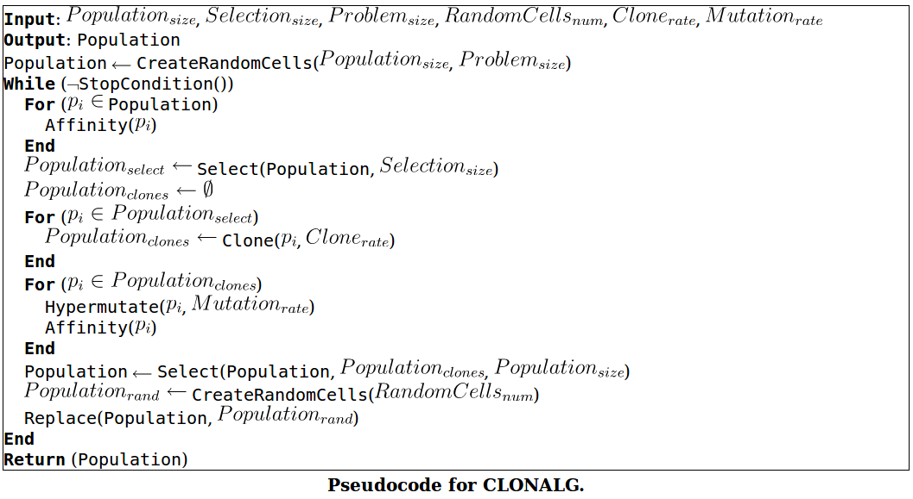
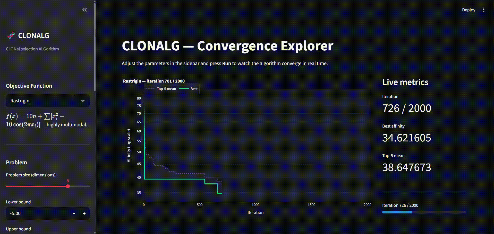

# CLONALG

A Python implementation of the **CLONal selection ALGorithm (CLONALG)** — a nature-inspired metaheuristic from the field of artificial immune systems. This project demonstrates how biological principles of immunity can be applied to solve continuous function optimization problems.

---

## Background

Clonal selection algorithms are inspired by the adaptive immune system's response to antigens. When the body encounters a pathogen, B-cells with the highest *affinity* (binding strength) to the antigen are selected, cloned, and subjected to *somatic hypermutation* — a process that refines the response over successive generations. CLONALG applies this mechanism to optimization: candidate solutions act as antibodies, and the objective function plays the role of the antigen.

<p align="center">
  
</p>

---

## Features

- Clean, modular implementation separated into pure-function core and a high-level runner
- Injectable objective function — apply the algorithm to any continuous minimization problem
- `CLONALGConfig` and `CLONALGResult` dataclasses for ergonomic configuration and result inspection
- Bug-free cloning: clone count is inversely proportional to **rank**, not raw affinity score, following the standard CLONALG formulation
- Interactive Streamlit app for parameter exploration with a live convergence chart
- Dependency management with [`uv`](https://github.com/astral-sh/uv) and code quality enforced with [`ruff`](https://github.com/astral-sh/ruff)

---

## Project Structure

```
src/clonalg/
├── core.py        # Pure algorithmic functions: evaluate, create_population, clone, hypermutate, select, replace
├── runner.py      # CLONALGConfig, CLONALGResult, and the main run() loop
└── __init__.py    # Public API

app.py             # Streamlit app
notebooks/
└── CLONALG - Implementation and Execution.ipynb  # Demo notebook
```

---

## Algorithm Overview

| Step | Biological analogy | Implementation |
|---|---|---|
| Initialize population | Naive B-cell repertoire | `create_population()` |
| Evaluate affinity | Antigen-antibody binding | `evaluate()` with injectable `objective_fn` |
| Select top candidates | Clonal selection | `population_scored[:selection_size]` |
| Clone | Cell proliferation | `clone(individual, rank, clone_rate)` |
| Hypermutate | Somatic hypermutation | `hypermutate()` — mutation rate ∝ affinity |
| Reselect survivors | Affinity maturation | `select()` |
| Replace worst | Repertoire diversity | `replace()` with new random cells |

---

## Getting Started

### Prerequisites

This project uses [`uv`](https://github.com/astral-sh/uv) for dependency management.

```bash
# Install uv (if not already installed)
curl -LsSf https://astral.sh/uv/install.sh | sh

# Clone the repository
git clone https://github.com/christianrfg/clonalg.git
cd clonalg

# Install dependencies
uv sync --all-groups
```

### Streamlit App

```bash
uv run streamlit run app.py
```

<p align="center">
  
</p>

The app lets you explore how different parameters affect the algorithm's convergence without writing any code:

- **Objective function** — choose between Sphere (unimodal), Rastrigin (highly multimodal), or Rosenbrock (narrow curved valley)
- **All algorithm parameters** — population size, selection size, clone rate, mutation rate, number of iterations, and more, all configurable via sidebar sliders
- **Live convergence chart** — an interactive Plotly chart updates in real time as the algorithm runs, showing the best affinity and top-5 mean per iteration on a log scale
- **Live metrics** — current iteration, best affinity, and top-5 mean update alongside the chart
- **Final result** — after convergence, the best solution vector and objective value are displayed per dimension

### Jupyter Notebook

```bash
uv run jupyter notebook notebooks/
```

The notebook demonstrates the algorithm on a chosen objective function (Sphere, Rastrigin, or Rosenbrock), runs it once, and displays a final interactive convergence chart.

---

## Usage

```python
import sys
sys.path.insert(0, "src")

import numpy as np
from clonalg import CLONALGConfig, run

def sphere(x: np.ndarray) -> float:
    return float(np.sum(x ** 2))

config = CLONALGConfig(
    problem_size=3,
    b_lo=-5.0,
    b_up=5.0,
    population_size=100,
    selection_size=10,
    clone_rate=20,
    mutation_rate=0.2,
    max_iterations=1000,
)

result = run(sphere, config)
print(result.best_solution)   # np.ndarray — best solution found
print(result.best_affinity)   # float — objective value at best solution
```

---

## Development

```bash
uv run ruff format src/ app.py       # format
uv run ruff check src/ app.py        # lint
uv run ruff check src/ app.py --fix  # lint and auto-fix
```

---

## References

- [Clonal Selection Algorithm — Clever Algorithms](http://www.cleveralgorithms.com/nature-inspired/immune/clonal_selection_algorithm.html)
- [Clonal Selection Algorithm — Wikipedia](https://en.wikipedia.org/wiki/Clonal_selection_algorithm)
- de Castro, L. N., & Von Zuben, F. J. (2002). *Learning and optimization using the clonal selection principle*. IEEE Transactions on Evolutionary Computation.

---

## License

Distributed under the MIT License. See [`LICENSE.md`](LICENSE.md) for details.
